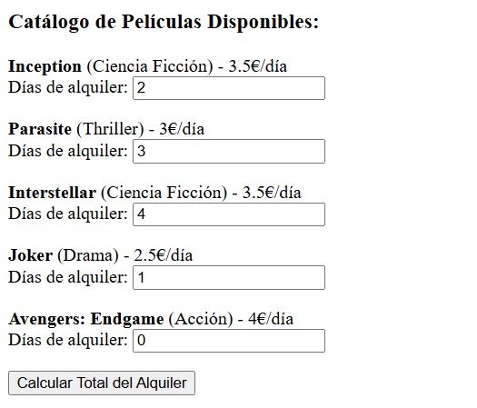
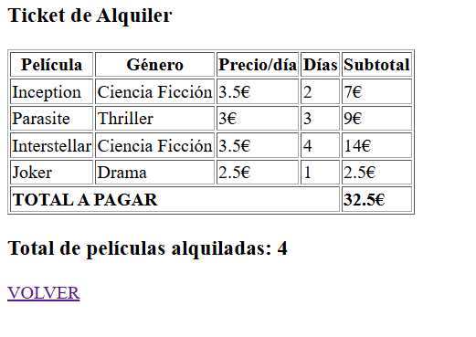
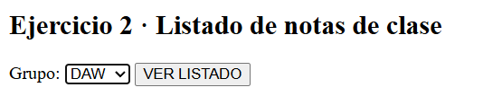
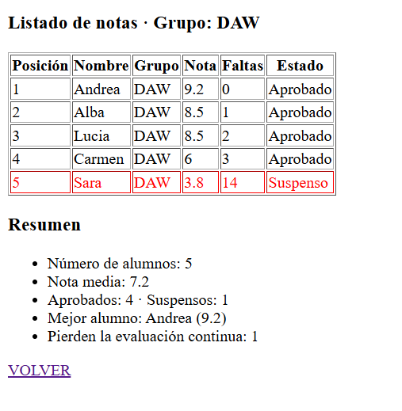

# Práctica 2 · Manejo de formularios y arrays (versión 5.1)

Recordad:

- `error_reporting(E_ALL);` para recoger errores.
- `ini_set("display_errors", 1);` para mostrar errores en el navegador.
- `sort()` ordena un array por valor de menor a mayor **reseteando las claves**.
- `rsort()` ordena un array por valor de mayor a menor **reseteando las claves**.
- `asort()` ordena un array por valor de menor a mayor **manteniendo las claves originales**.
- `arsort()` ordena un array por valor de mayor a menor **manteniendo las claves originales**.
- `ksort()` ordena un array por sus claves en orden ascendente; `krsort()`, en orden descendente.
- `isset()` comprueba si existe un valor para una clave.
- `is_numeric()` comprueba si un dato es un número (o un texto que contiene un número).
- `round($numero, $decimales)` redondea un número a los decimales indicados.
- `array_column($array, "campo")` devuelve un array simple con los valores de ese campo de cada fila de un array bidimensional.
- `array_multisort()` ordena un array bidimensional usando como criterios las columnas sacadas con `array_column`. El **último** parámetro es el array que se quiere ordenar. Por ejemplo, para ordenar unos productos por precio de mayor a menor y, si cuestan lo mismo, por nombre de la A a la Z:


La solución se entregará en el aula virtual como un fichero zip con el siguiente formato:

`nombre_apellido1_apellido2.zip`

| Ejercicio | Puntos |
|---|---|
| Ejercicio 1 · Alquiler de películas | 4 |
| Ejercicio 2 · Listado de notas de clase | 6 |

## Ficheros (`practica2.html` y `soluciones.php`)

Los **dos formularios** están en el mismo fichero `practica2.html` y las **dos soluciones** en el mismo fichero `soluciones.php`. Ambos formularios usan el método **POST** y envían sus datos a `soluciones.php`.

Para que `soluciones.php` sepa qué formulario se ha enviado, cada formulario lleva un campo oculto:

```html
<input type="hidden" name="ejercicios" value="ej1">
```

En `soluciones.php`, cada ejercicio va dentro de su propio bloque:


La página no debe mostrar ningún *Warning* ni *Notice* por lo que deberás de ser capaz de controlar que el código PHP del ejercicio 1 no interfiera con el del ejercicio 2 y viceversa.

---

## Ejercicio 1 · Alquiler de películas (4 puntos)

Contamos con un array asociativo bidimensional ya creado con la siguiente forma:

```php
$peliculas = [
    "inception" => [
        "titulo" => "Inception",
        "genero" => "Ciencia Ficción",
        "precio_dia" => 3.50
    ],
    "parasite" => [
        "titulo" => "Parasite",
        "genero" => "Thriller",
        "precio_dia" => 3.00
    ],
    "interstellar" => [
        "titulo" => "Interstellar",
        "genero" => "Ciencia Ficción",
        "precio_dia" => 3.50
    ],
    "joker" => [
        "titulo" => "Joker",
        "genero" => "Drama",
        "precio_dia" => 2.50
    ],
    "avengers" => [
        "titulo" => "Avengers: Endgame",
        "genero" => "Acción",
        "precio_dia" => 4.00
    ]
];
```

Vamos a simular un alquiler de películas. Para ello contaremos con un formulario con el método POST en el que se inserta el **número de días** que alquilamos cada película (dejar a 0 si **no** queremos alquilar alguna de las películas).

### Formulario (en `practica2.html`)

Para cada película se muestra su título en negrita, su género y su precio por día, y debajo un campo numérico *"Días de alquiler"*. **El `name` de cada campo es la clave de la película en el array** (`inception`, `parasite`…), para que en PHP se pueda leer como `$_POST[$clave]` al recorrer `$peliculas`.

### Procesamiento (en `soluciones.php`)

*CONSEJO*: Para solucionar este ejercicio, puedes crear un array `$alquiler` donde guardes el título, género, precio por día, número de días de alquiler de la peli y subtotal.

1. Si los días son un número mayor que 0, calcula el subtotal (días × precio por día) y añade una fila al array `$alquiler` con el título, el género, el precio por día, los días y el subtotal. Ve sumando el total a pagar.
2. Muestra el **ticket de alquiler** en una tabla HTML recorriendo `$alquiler`, con las columnas Película, Género, Precio/día, Días y Subtotal, y una última fila con el **TOTAL A PAGAR**.
3. Debajo, muestra el **total de películas alquiladas**.
4. Si no se ha alquilado ninguna película, en lugar del ticket muestra *"No has seleccionado ninguna película para alquilar"*.

### Captura de pantalla con ejemplos:

### CAPTURA 1


### CAPTURA 2


Avengers no aparece porque se ha dejado a 0.

---

## Ejercicio 2 · Listado de notas de clase (6 puntos)

Tenemos las notas de la evaluación de dos grupos en un array bidimensional (cada fila es un alumno):

```php
$alumnos = [
    ["nombre" => "Lucia",  "grupo" => "DAW", "nota" => 8.5,  "faltas" => 2],
    ["nombre" => "Marcos", "grupo" => "DAM", "nota" => 6,    "faltas" => 5],
    ["nombre" => "Andrea", "grupo" => "DAW", "nota" => 9.2,  "faltas" => 0],
    ["nombre" => "Pablo",  "grupo" => "DAM", "nota" => 4.5,  "faltas" => 12],
    ["nombre" => "Carmen", "grupo" => "DAW", "nota" => 6,    "faltas" => 3],
    ["nombre" => "Hugo",   "grupo" => "DAM", "nota" => 8.5,  "faltas" => 1],
    ["nombre" => "Sara",   "grupo" => "DAW", "nota" => 3.8,  "faltas" => 14],
    ["nombre" => "Diego",  "grupo" => "DAM", "nota" => 7.25, "faltas" => 4],
    ["nombre" => "Alba",   "grupo" => "DAW", "nota" => 8.5,  "faltas" => 1],
    ["nombre" => "Bruno",  "grupo" => "DAM", "nota" => 6,    "faltas" => 7]
];
```

### Formulario (en `practica2.html`)

1. El formulario tiene:
   - Un `<select>` llamado `grupo` con las opciones **Todos** (`value="todos"`), **DAW** y **DAM**.
   - Un botón **VER LISTADO**.

### Procesamiento (en `soluciones.php`)


2. Recorre `$alumnos` y guarda en un nuevo array `$listado` solo los alumnos del grupo elegido (o todos, si se ha elegido *Todos*).
3. **Ordena** `$listado` usando `array_column` y `array_multisort` con **dos criterios**:
   - Primero, por **nota** de mayor a menor.
   - Si dos alumnos tienen la misma nota, por **nombre** de la A a la Z.
4. Muestra el listado ordenado en una tabla HTML con las columnas **Posición**, **Nombre**, **Grupo**, **Nota**, **Faltas** y **Estado** (*Aprobado* si la nota es 5 o más, *Suspenso* si no). Las filas de los alumnos con **más de 10 faltas** van con el texto en rojo, porque pierden la evaluación continua.
6. Debajo de la tabla, muestra un **resumen** del listado recorriéndolo:
   - Número de alumnos.
   - Nota media, redondeada a 2 decimales.
   - Número de aprobados y de suspensos.
   - Nombre y nota del **mejor alumno** (después de ordenar, es el primero del listado).
   - Número de alumnos que pierden la evaluación continua.

### Ejemplo con capturas de pantalla

### CAPTURA 1


### CAPTURA 2



Suerte chic@s :D
